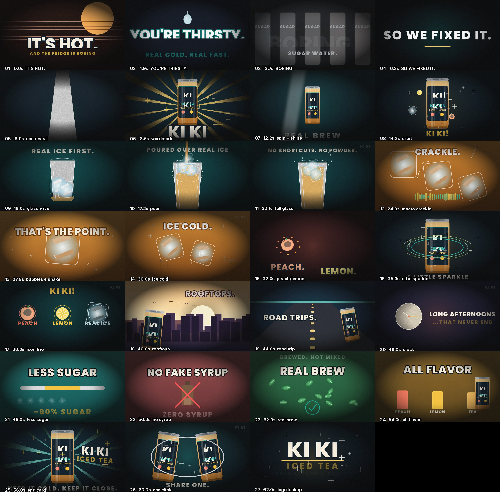

# code-motion-graphics

Build an animated ad **from code**. Frames are drawn in Python (Pillow + numpy), the score is
synthesised with numpy, the voiceover comes from edge-tts, and ffmpeg assembles and levels it.
No GPU, no manim, no Blender, no stock footage, no licensed music, no cloud service, no API keys
for the visuals.

Two things live here:

- **`SKILL.md`** - the playbook: the timing model, the renderer kit, the cool-factor cookbook, the
  audio recipe, the verification gates, and the pitfalls that actually cost time. Read it first.
- **`example/kiki-iced-tea/`** - a complete worked ad: 64 s, 1920x1080, 30 fps, 8 shots, 27 cuts,
  11 voiceover lines, an original 120 BPM score plus foley. Roughly 5 minutes of render on 4 vCPU.



*The captioned 27-cut storyboard the renderer emits for review, before you spend render time.*

`Ki Ki` is a fictional iced tea brand invented for the demo. No real product, no real claim.

## Pipeline

| stage | file | what it does |
|---|---|---|
| 1. voice | `vo.py` | one edge-tts call per line, silence-trimmed, compressed and EQ'd, writes `vo/timing.json` |
| 2. score | `score.py` | synth primitives (kick, clap, hat, bass, pluck, pad, riser) + foley (can crack, pour, ice clinks, crackle, chime), ducked under the voice from `timing.json`, mixed with headroom |
| 3. review | `render.py stills` | one frame per cut, sampled mid-beat, tiled into a captioned contact sheet |
| 4. render | `render.py range` x4 | 4 parallel chunks, boundaries on shot boundaries, each piping rawvideo straight into its own x264 encode |
| 5. assemble | `mix_and_mux.sh` | concat, loudness-normalise with a true-peak ceiling, mux, make delivery copies |

Why that order: the voice sets the timing, the timing sets the shot grid, the shot grid is what makes
cuts land on the music. Pictures last.

## Requirements

| need | tested with |
|---|---|
| python3 | 3.11 |
| Pillow | 12.3 |
| numpy | 2.4 |
| ffmpeg | 6.1 (needs libx264 + aac) |
| edge-tts | `pip install edge-tts` (network required at voice stage only) |
| fonts | `~/.fonts/Poppins-ExtraBold.ttf` (static display), `~/.fonts/Inter.ttf` (variable), `~/.fonts/JetBrainsMono.ttf`. Override with `POP_FONT` / `INT_FONT` / `MONO_FONT`. Check with `fc-list \| grep -iE "inter\|poppins\|montserrat"` |

No GPU is used at any point. 4 vCPU / 7 GB RAM rendered this ad comfortably.

## Quick start

```bash
git clone https://github.com/Hermes-mahers-bot/code-motion-graphics
cd code-motion-graphics/example/kiki-iced-tea

python3 vo.py             # 11 VO lines -> vo/*.wav + vo/timing.json      (~30 s)
python3 score.py          # score + foley + ducked VO -> mix/audio.wav    (~6 s)
python3 render.py stills  # 27-frame storyboard -> contact_sheet.jpg      (~20 s)  <- LOOK AT THIS
bash render_all.sh        # 4 parallel chunks -> video_silent.mp4         (~5 min on 4 vCPU)
bash mix_and_mux.sh       # levels + mux -> kiki_ad.mp4 + delivery copies
python3 verify.py         # VO audibility table + frames from the final mp4
```

Outputs: `kiki_ad.mp4` (1080p crf 19 master, ~88 MB), `kiki_ad_deliver.mp4` (crf 25, ~12 MB, chat
friendly), `kiki_ad_720p.mp4` (~6.4 MB), `poster.jpg`.

Adapting it to another brand is editing `render.py` (shots, palette, copy) plus the `LINES` dict in
`vo.py`. The timing model, the kit and the audio chain stay as they are.

## Measured numbers

| metric | value |
|---|---|
| render cost | 0.73 s/frame single-threaded at 1080p -> ~23 min for 64 s, ~5 min across 4 chunks |
| master | 1920x1080, 30 fps, 1920 frames, exactly 64.000 s, 88 MB, crf 19 |
| delivery copies | 1080p crf 25 = 12 MB; 1280x720 crf 23 = 6.4 MB |
| audio | 44.1 kHz stereo AAC 192k, mean -19.2 dB, true peak -2.5 dB (no clipping) |
| voiceover level | 1 to 4 dB above the music bed in every VO window (measured, not eyeballed) |

## Verification gates

Never ship a video you have only "rendered". The gates in `SKILL.md` section 7 are:

1. look at the stills sheet (clipped text, dead frames, missing product, wrong colour)
2. `ffprobe`: frame count must equal `TOTAL * FPS` exactly, duration exact
3. VO audibility table: >= 4 dB separation from the bed, else drop the music bus
4. no silent stretch longer than ~0.8 s
5. `volumedetect` on the final mp4: peak between -1 and -4 dB, never 0.0 dB
6. pull frames out of the final mp4 and eyeball them

`scripts/validate_kit.py` re-checks that the code printed inside `SKILL.md` still runs, so the
documented kit cannot rot into something that does not work.

## Files

```
SKILL.md                       the playbook (read first)
AGENTS.md                      runbook for AI agents: commands, gates, hard rules
scripts/validate_kit.py        extracts + executes the kit in SKILL.md, checks beat() dispatch
example/kiki-iced-tea/
  render.py                    kit + 8 shots + 27 cuts, `stills` and `range` modes
  vo.py                        voiceover generation, trimming, broadcast chain, timing.json
  score.py                     synth score, foley, ducking, mix and headroom
  render_all.sh                4-way parallel chunk render + concat
  mix_and_mux.sh               loudness pass, mux, delivery copies
  verify.py                    audio level map + frames from the final mp4
  contact_sheet.jpg            the 27-cut storyboard
  poster.jpg                   thumbnail frame
```

## License

MIT, see `LICENSE`.
